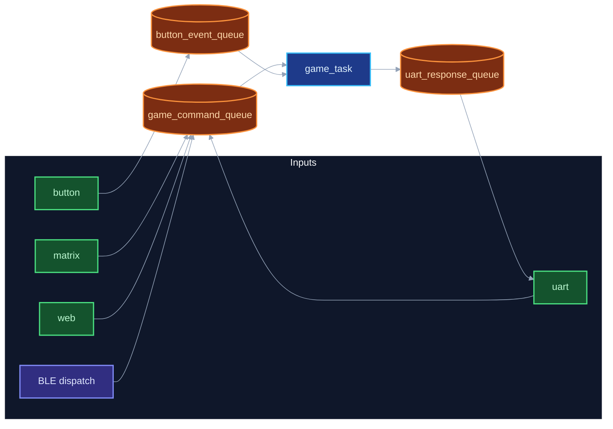

# CzechMate

**Product site:** [alfredkrutina.github.io/CzechMate/downloads.html](https://alfredkrutina.github.io/CzechMate/downloads.html)

Smart physical chess — real pieces, lights on the squares, and an app that teaches. Firmware on ESP32-C6 is Hall I2C. Flutter client is in `flutter_czechmate/`.

**Firmware in this repo:** **1.8.0**, live build is **Hall** (I2C). Occupancy, piece type, and color come from the Hall pair. The reed **V1** prototype is archived in [kos/v1-reed](kos/v1-reed) and is not linked. Sensing limits: [rozpoznani-figur-2026-10-23.md](context/firmware/rozpoznani-figur-2026-10-23.md). Wiring: [WIRING_ESP_STM4.md](context/hardware/WIRING_ESP_STM4.md).

**Download the app:** same [product page](https://alfredkrutina.github.io/CzechMate/downloads.html) · binaries on [GitHub Releases](https://github.com/AlfredKrutina/CzechMate/releases/latest). **Windows:** no BLE scan — connect via Wi‑Fi URL ([docs/flutter/README.md](docs/flutter/README.md)). **iOS / iPad** support is in progress.

*Checkmate from Czechia*

**Docs:** [docs/README.md](docs/README.md) · [REPO_LAYOUT.md](context/firmware/REPO_LAYOUT.md) · [TROUBLESHOOTING.md](context/firmware/TROUBLESHOOTING.md)

---

## About

CzechMate is one stack: FreeRTOS firmware, physical sensing, LED feedback, board web UI, and a Flutter app. You play on a real board; the system tracks the position, lights legal / hint squares, and can coach through the phone.

Longer notes (history, license): [PROJECT_NOTES.md](context/firmware/PROJECT_NOTES.md).

---

## Features

| Area | What you get |
|------|----------------|
| Piece sensing | Hall pairs over I2C. The firmware reports occupancy, piece type, and color. Limits of that recognition are in `context/firmware/rozpoznani-figur-2026-10-23.md`. Reed V1 is archived in `kos/v1-reed`. |
| LEDs | 73× WS2812B (64 squares + 9 near the buttons) — moves, check, mate, errors, teaching animations |
| Chess rules | Castling, en passant, promotion, check, mate |
| Clients | Flutter app (BLE on mobile, Wi‑Fi on desktop), board web UI, UART console |
| Training | Stockfish bot, ELO, hints, move evaluation, AI coach |
| Updates | Firmware OTA from the app / board web / Wi‑Fi — no cable to the chip for routine updates |
| Home | MQTT light for Home Assistant (`ha_light_task`) |

---

## Hardware

Hardware documentation is split by generation:
- **V1 (reed matrix prototype, archived):** [kos/v1-reed/hardware/v1-reed-matrix/README.md](kos/v1-reed/hardware/v1-reed-matrix/README.md)
- **V2 Hall board:** [WIRING_ESP_STM4.md](context/hardware/WIRING_ESP_STM4.md) and [HARDWARE_VERSIONS.md](context/hardware/HARDWARE_VERSIONS.md). There is no `hardware/v2-hall-stm32/README.md` in the tree.
- **Comparison:** [HARDWARE_VERSIONS.md](context/hardware/HARDWARE_VERSIONS.md) · **V2 wiring:** [WIRING_ESP_STM4.md](context/hardware/WIRING_ESP_STM4.md)

### V1 pin map (archived, not initialized)

The live image does not multiplex these pins. GPIO23 is the V2 gesture button. GPIO15 is STM32 NRST on the Hall board.

```
LED Data:        GPIO7
Matrix Rows:     GPIO10,11,18,19,20,21,22,23
Matrix Columns:  GPIO0,1,2,3,6,4,16,17
Status LED:      GPIO5
Reset Button:    GPIO15
```

---

## Architecture

FreeRTOS multitasking — priorities, queues, mutexes: [TASK_COMMUNICATION.md](context/firmware/TASK_COMMUNICATION.md). Diagrams: [context/diagrams/README.md](context/diagrams/README.md).

| Task / runtime | Priority | Stack |
|----------------|----------|-------|
| `led_task` | 7 | 8 KB |
| `squares_task` | 6 | 4 KB |
| `button_task` | 5 | 3 KB |
| `game_task` | 4 | 6 KB |
| `uart_task`, `web_server_task`, `ha_light_task` | 3 | 5–20 KB |
| `test_task` (menuconfig) | 1 | 4 KB |
| **NimBLE host** | ESP-IDF | BLE via `ble_task_init()` |

`animation_task` is **disabled** — animations run in `led_task` / `unified_animation_manager`.



Components under `components/`: [REPO_LAYOUT.md](context/firmware/REPO_LAYOUT.md).

---

## Build & flash

```bash
. $IDF_PATH/export.sh
idf.py menuconfig    # optional
idf.py build
idf.py -p PORT flash
idf.py -p PORT monitor
```

**Hall V2 profile:** `sdkconfig.defaults.hall_v2` — see [WIRING_ESP_STM4.md](context/hardware/WIRING_ESP_STM4.md).

**Home Assistant:** MQTT RGB light — default broker `homeassistant.local:1883`, NVS namespace `mqtt_config`.

---

## Usage

| Channel | How |
|---------|-----|
| **UART** | 115200 baud — `help`, `move e2e4`, `board`, `reset` |
| **Web** | `http://<IP>/` after Wi‑Fi (IP in the log) |
| **Flutter** | `cd flutter_czechmate && flutter pub get && flutter run` |
| **Releases** | [GitHub Releases](https://github.com/AlfredKrutina/CzechMate/releases) |

**Physical play:** lift a piece → LED on the source square; place → validation. Green = OK, red = error, blue = check.

**Bot / training on the web:** Stockfish (chess-api.com), ELO 1–8, hints, color-coded move quality.

---

## Documentation

| Document | Contents |
|----------|----------|
| [docs/README.md](docs/README.md) | Documentation index |
| [kos/v1-reed/hardware/v1-reed-matrix/README.md](kos/v1-reed/hardware/v1-reed-matrix/README.md) | Archived V1 reed board. Not the live firmware. |
| [context/hardware/WIRING_ESP_STM4.md](context/hardware/WIRING_ESP_STM4.md) | Hall board wiring and STM32 boot |
| [context/diagrams/README.md](context/diagrams/README.md) | Mermaid / SVG architecture diagrams |
| [docs/flutter/README.md](docs/flutter/README.md) | Flutter client app |
| [context/firmware/ota_architecture.md](context/firmware/ota_architecture.md) | Firmware OTA channels |
| [context/firmware/REPO_LAYOUT.md](context/firmware/REPO_LAYOUT.md) | Repository inventory |
| [context/firmware/TROUBLESHOOTING.md](context/firmware/TROUBLESHOOTING.md) | Debugging & diagnostics |
| [context/firmware/PROJECT_NOTES.md](context/firmware/PROJECT_NOTES.md) | Version history, license |
| [gh-pages-ready/README.md](gh-pages-ready/README.md) | Product site deployment |

**Doxygen:** `./scripts/docs/generate_docs.sh` → `doxygen/html/index.html`  
**Diagrams:** `./scripts/render_docs.sh`

**V2 forms:** [pre-order](https://docs.google.com/forms/d/18ns5uSUSzr5zcHsiZwD1HWfY15xBa-folmE-oH86BsY/viewform) · [survey](https://docs.google.com/forms/d/e/1FAIpQLSck_q6sjN1nnUs9aV2CsY0MyPNo9puLcncW603iEJz6BMLjPw/viewform)

---

**README version:** 1.8.0 · **2026**
